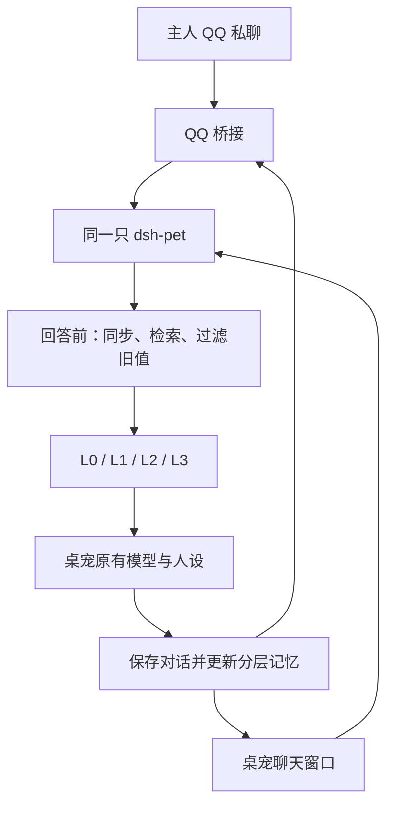

# 大肥鱼 QQ 分层记忆桥

让电脑上的大肥鱼和手机 QQ 里的机器人，使用**同一只桌宠、同一份人设和一套分层记忆**。

在桌面说过的事，可以去 QQ 接着聊；在 QQ 保存的长期事实，也能在桌面读出来。QQ 消息走桌宠原有的回答流程，桌面小人也会同步显示回复。

> 实验版 `0.1.0`。目前兼容补丁只支持 **dsh-pet 0.3.8**。它是社区项目，不是腾讯或 DeepSeek 官方插件。安装前请阅读下面的前置条件和版本范围。

## 必须先装这两个插件

| 前置插件 | 用途 | 使用桥接时的状态 |
| --- | --- | --- |
| [dsh-pet](https://github.com/PC2005-cloud/dsh-pet) | 桌面大肥鱼、原有人设、模型和聊天入口 | **保持启用**，且能正常聊天 |
| [腾讯官方 QQ 插件](https://github.com/tencent-connect/dsh-qqbot) `@tencent-connect/dsh-qqbot` | 创建机器人、扫码绑定、保存 QQ 凭据和主人白名单 | 完成绑定后**暂停，保留安装和配置** |

本项目是第三个插件。它接管 QQ 的消息收发，不要和官方 QQ 插件同时连接同一个机器人，否则可能重复回复或争抢连接。想用回原来的 QQ Agent：停用本桥接，再启用官方 QQ 插件即可。

## 记忆不是只有聊天记录

| 层级 | 保存什么 | 如何使用 |
| --- | --- | --- |
| **L0 原始对话** | 用户原话、桌宠回答、时间、来源 ID | 用于追溯和重建，不把全部历史塞给模型 |
| **L1 长期事实** | 喜好、项目、约定等有明确来源的信息 | 按相关性和时间排序，同键纠正会替换旧值 |
| **L2 场景摘要** | 每 6 轮普通对话生成的场景摘录，保留原始来源 ID | 只召回与当前问题相关的场景，不能当成新的事实 |
| **L3 人格/关系** | 稳定称呼、关系约定等用户明确设定的信息 | 优先选入上下文；桌宠自己的原有人设仍然保留 |

每次回答前，在桌宠的系统上下文里加入选中的记忆；近期聊天仍由桌宠原有窗口提供。默认最多选择 8 条 L3、8 条 L1、2 条 L2，记忆 JSON 总预算为 2400 字符。

这一版使用**明确指令、保守规则抽取和摘录式摘要**，不额外调用模型整理记忆，不使用向量数据库，也不会假装已经实现完整的语义记忆。只从用户明确自述中提取事实，不从 AI 的回答推断“你是谁”。记忆注入仍会增加正常聊天的输入 Token。



## 安装教程

### 1. 先让桌宠正常聊天

在 DSH 安装并启用 `dsh-pet`，配置好模型和 API Key。右键桌宠，打开“对话”，确认能正常回复。

当前只验证了 **dsh-pet 0.3.8**。如果版本不同，不要强行修改版本号绕过补丁检查。

### 2. 用官方插件创建并绑定 QQ 机器人

在 DSH 的“插件 → 添加插件”中安装：

```text
@tencent-connect/dsh-qqbot@latest
```

启用后打开“QQ 机器人”，按实际流程完成：

1. 手机 QQ 第一次扫码。
2. 新建机器人，给它命名。
3. 阅读相关协议，接受后勾选同意，完成创建。
4. 回到电脑页面，再次扫码，选择刚才的机器人并确认绑定。
5. 看到“已绑定”，并确认私聊白名单只有你自己。

**接下来暂停官方 QQ 插件，不要卸载或解绑。** 桥接只读它保存的凭据和唯一主人 OpenID，不会把凭据复制进项目。

### 3. 下载本项目

需要 Git、Node.js 22.13 或更新版本。终端执行：

```bash
git clone https://github.com/zizic04/dsh-pet-qq-bridge.git
cd dsh-pet-qq-bridge
npx pnpm@11.28.5 install --frozen-lockfile --ignore-scripts
```

在 DSH “添加插件”中填写**这个项目的完整本地目录**，安装并启用。默认 `enabled: false`，配置完成前不会连接 QQ。保留该目录，DSH 的本地安装可能使用链接引用它。

### 4. 安装桌宠兼容补丁

桌宠暂时没有公开的“回答前/后记忆扩展点”，所以需要一个很小的兼容补丁。它只在 `chatWithPet` 的两个位置接入记忆服务，不替换模型，不修改桌宠配置、素材或原有聊天文件。

以下是默认 Mac/Linux 桌面 profile 示例；如果你用自定义 `DSH_HOME`、Web profile 或 Windows，请把路径替换成自己的真实目录：

```bash
node src/patch-cli.js "$HOME/.dsh/profiles/desktop/node_modules/dsh-pet"
```

补丁先检查版本和两个唯一代码锚点，再备份原文件和 SHA-256 摘要，最后原子替换。未知版本、不同构建或损坏补丁会拒绝修改。**更新/重装 dsh-pet 可能覆盖补丁，需要重新检查兼容性。**

### 5. 配置同一只桌宠

先确认宠物 ID。默认大肥鱼通常是 `main`；多只宠物时请查看 `$DSH_HOME/dsh-pet/main-config.jsonc` 中目标宠物的 `id`，不要只看显示名称。

如果你的 profile 是默认桌面目录，宠物 ID 是 `main`：

```bash
node src/configure-profile.js "$HOME/.dsh/profiles/desktop" main
```

这个命令会：

- 检查官方 QQ 插件已经绑定，而且私聊白名单恰好只有一位主人。
- 备份 profile 原配置，只增加/更新桥接自己的条目。
- 引用原凭据存储位置，不输出或复制 AppSecret。
- 开启桥接并指定宠物 ID。

执行时不要同时在 DSH 中编辑设置。**完成后退出并重新打开 DSH**，让桌宠补丁和分层记忆插件一起加载。

### 6. 验证两边真的是同一份记忆

先在桌宠的“对话”窗口发送：

```text
/记住 联调暗号=白饭小屋7319
```

再在手机 QQ 发送：

```text
/记忆
```

```text
联调暗号是什么？
```

反过来，在 QQ 发送：

```text
/记住 手机联调=白饭小屋8426
```

回到桌宠聊天窗口询问“手机联调的值是什么？”。两边都能接上，才算完整接通。

注意：桌面输入位置是**桌宠自己的对话窗口**。DSH 主界面的普通 Agent 会话不属于这套桌宠记忆。

## 日常怎么用

以下记忆命令在桌宠窗口和主人 QQ 私聊里都有效：

| 命令 | 作用 |
| --- | --- |
| `/记住 饮料=冰美式` | 保存到 L1 长期事实 |
| `/记住 饮料=热牛奶` | 纠正同一事实，旧值退出召回和近期上下文 |
| `/人设 称呼=鱼老板` | 保存到 L3 人格/关系 |
| `/记忆` | 查看有效长期信息和各层统计 |
| `/记忆 帮助` | 查看记忆指令 |
| `/忘记 饮料` | 停止召回相关事实、场景和近期上下文 |
| `/pet-status` 或 `/bot-ping` | QQ 专用：检查本地桌宠接口连通性 |
| `/pet-help` | QQ 专用：查看桥接帮助 |

保守自动抽取支持类似“请记住：我喜欢冰美式”“请记住：以后叫我鱼老板”的**整句明确自述**。重要事项建议使用 `/记住 键=值`，结果更可控。场景摘要是用户话语摘录，不是 LLM 生成的总结。

**“忘记”是停止召回，不是物理删除。** 为了审计和重建，L0 日志、桌宠原始 `memory.json` 和备份中仍可能保存原文。它按字面关键词过滤，暂不保证同义改写或模型推断也被消除。

## 数据与边界

- 只允许配置的一个主人私聊。群聊、频道和其他用户不会读取或写入桌宠记忆。
- 本机桌宠接口仅接受回环地址；不需要公网端口或内网穿透。
- 分层记忆保存在 `$DSH_HOME/pet-qq-memory/<宠物ID摘要>/events.jsonl`，默认 `DSH_HOME` 为 `~/.dsh`。目录权限 `0700`、日志权限 `0600`（受系统文件权限能力影响）。
- `events.jsonl` 是事务日志，四层视图可以从日志恢复。单写者锁防止两个实例同时写入；发现不完整日志会停止写入，不能自动丢弃记录。
- 模型仍使用桌宠现有配置。被召回的信息会随正常模型请求发送给你配置的模型服务；QQ 里显示的内容会经过 QQ 平台。
- 纯文字首版。图片、语音、文件、群共享记忆、Agent 工具执行、任务审批和定时主动推送均不支持。
- 绑定前的普通 QQ Agent 历史不会自动迁移。桌宠原有历史会在首次对话时同步为 L0，并按规则整理。
- QQ 消息在当前进程内去重 10 分钟，重启后的平台重复投递不保证去重。超时不自动重试，因为桌宠可能已写入结果。
- 长回复只发送一条 QQ 消息，超长部分提示去桌宠窗口查看。电脑需保持联网、DSH 保持运行。
- 本补丁覆盖桌宠的交互聊天。周期“碎碎念”没有接入分层检索；它仍走桌宠原来的生成逻辑。

## 回退

1. 在 DSH 停用本桥接插件。
2. 如需回到原 QQ Agent，重新启用腾讯官方 QQ 插件。
3. 要恢复桌宠原代码，在本项目目录执行：

```bash
node src/patch-cli.js "$HOME/.dsh/profiles/desktop/node_modules/dsh-pet" --restore
```

恢复前会核对当前文件和备份哈希，不会把过期备份覆盖到升级后的桌宠上。随后重启 DSH。记忆数据不自动删除。

## 开发与测试

```bash
npx pnpm@11.28.5 check
```

测试覆盖访问控制、消息去重、串行队列、错误处理、真实本地 HTTP 协议、四层记忆、跨窗口保留、重启恢复、纠正、遗忘、召回预算和文件写锁。

已在 **macOS、DSH 0.2.1-rc.5、dsh-pet 0.3.8、QQ 官方插件 0.5.5 的绑定配置**上做真实双向联调。自动化测试和人工验证的区别、结果与限制见 [测试记录](TESTING.md)。其他系统和版本尚未做真人 QQ 端到端验收。

## 致谢与许可

- [dsh-pet](https://github.com/PC2005-cloud/dsh-pet)：桌宠、聊天接口与原始记忆存储。
- [腾讯 QQ 插件](https://github.com/tencent-connect/dsh-qqbot)：机器人创建/绑定流程。
- [腾讯 QQ Node.js SDK](https://github.com/tencent-connect/qqbot-nodejs)：QQ 消息连接。

本项目使用 MIT 许可；不包含桌宠形象、动画、用户聊天、API Key 或 QQ 凭据。兼容补丁的少量匹配片段来自 MIT 许可的 dsh-pet，保留说明见 [第三方声明](THIRD_PARTY_NOTICES.md)。
